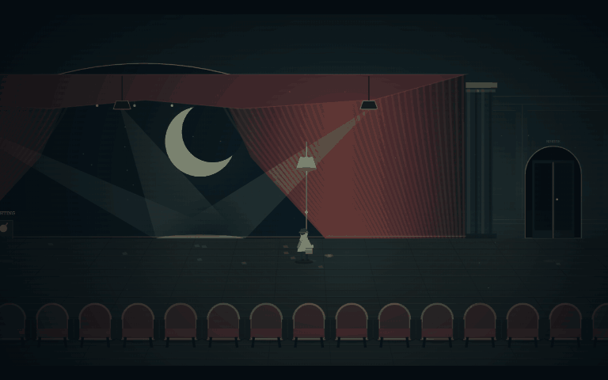

# 残響座 — THE LAST CUE



閉鎖された劇場に最後の招待状を届ける、配達人の短い物語。
灯りをつなぎ、月を吊り上げ、拍手の主から逃れ、終演の鐘を鳴らす。
オリジナルの世界・人物・物語による、ブラウザ向けシネマティック脱出ゲームです。

## プレイ

Node.js 22 以降を用意し、このフォルダーで実行してください。追加パッケージのインストールは不要です。

```sh
npm start
```

[ゲームを開く](http://127.0.0.1:4187) — タイトルの「幕を開ける」で開始します。
サーバーはローカルホストだけに公開されます。ポートが使用中の場合は `server.js` の `4187` を変更してください。
静的な `index.html`、`style.css`、`rules.js`、`game.js` のみでゲームが動作するため、一般的な静的ホスティングにも配置できます。

## 特徴

- 受付、無人の客席、舞台裏、搬入口、大舞台を巡る全5幕。開始から脱出・エンディングまで実装。
- 手掛かりの探索、照明の順序、釣合い錘、三つの集光という劇場の設備を使った謎解き。
- 横移動と床面の奥行き移動。背景・人物・前景のレイヤー、遠近の床、視差による疑似3Dの2.5D表現。
- 部屋別の画角、速度に応じた先読み、指数減衰による追従、仕掛けへの視線誘導、終幕の引きの構図。
- 追跡とジャンプ。捕まった場合は同じ幕から再開し、解いた謎は失いません。
- 赤い幕、緑青の壁、真鍮の灯体に統一した手続き型の描画。光の束、埃、霧、前景の客席。
- Web Audio による持続音、足音、機械音、鐘。音声・絵・フォントの外部ダウンロードはありません。
- 自動保存、手帳のヒント、ポーズ、音の切替、カメラ振動軽減。タブを離れると自動ポーズ。

初見での探索を含め10〜20分を目標に設計しましたが、第三者による初見プレイ時間の検証は未実施です。解答を知って走る場合は大幅に短くなります。商業製品相当の品質保証を済ませたものではありません。

## 操作

| 操作 | キー |
| --- | --- |
| 左右へ移動 | A / D または ← / → |
| 奥・手前に移動 | W / S または ↑ / ↓ |
| 走る | Shift を押しながら移動 |
| ジャンプ | Space |
| 調べる・操作する | E または画面下の操作ボタン |
| 手帳・ヒント | J |
| 一時停止・閉じる | Esc |
| 音の切替 | M または右上の SOUND |

謎解きのパネルはクリックでもキーボードの Tab / Enter でも操作できます。
タッチ端末には移動・走る・ジャンプボタンを表示します。ただし実機タッチ操作の検証は未完了です。
セーブはブラウザの localStorage に保存され、同じブラウザ・同じURLの「つづきから」で、直近の幕の入口から復帰します。
謎の解答状況と取得記録を保存し、歩いた位置や未確定の照明順序は保存しません。

## 技術とアセット

- JavaScript / HTML / CSS、Canvas 2D、Web Audio API、requestAnimationFrame。
- ゲームエンジン：専用の軽量な自作ランタイム。WebGL/3Dモデルを使うエンジンではありません。
- 描画はコードによるオリジナルのベクター形状・グラデーション・視差合成。第三者の画像・音楽素材なし。
- システム搭載フォントを使用。追加フォントの同梱なし。
- Node.js 標準ライブラリだけの開発サーバー。
- GIF組み立て：Python / Pillow。ゲーム実行にはPythonは不要。

## AI制作情報

- AIサービス：OpenAI Codex（デスクトップアプリ）。
- 実際に使用したモデル：セッションの指示上は **GPT-6**。具体的なAPIモデルID・モデルのサブバージョンは **未確認**。
- 画像生成AI・外部素材生成サービス：使用していません。
- サブエージェント：使用していません。

## 実プレイの録画

冒頭の `docs/demo.gif` はブラウザで動いているゲームのCanvasを、実際に操作しながら100msごとに取得した120フレームから作成しています。12秒・10fps・768×480、無音です。架空のプレイ映像や補間生成映像ではありません。DOMのHUDは含まず、ゲーム画面とカメラ演出を収録しています。

再収録する場合：

1. `npm start` で起動し、`http://127.0.0.1:4187/?capture` を開く。
2. ゲーム中に R を押し、12秒間プレイする。
3. `docs/frames/` にPNGが保存される。
4. Pillowを利用できるPythonで `python tools/make_gif.py` を実行する。

MP4の長尺動画は未作成です。録画用エンドポイントはこのローカル開発サーバー専用です。

## 動作確認

- 2026-10-20、Windows上のCodex内蔵ブラウザで起動と実プレイを実施。
- 第一幕から第五幕まで実際のキー操作・パネル操作で進行。
- 照明の誤順序リセット、正しい順序の解錠、錘の設定、追跡中の走行・ジャンプ・非常灯を確認。
- 第三幕でページを再読み込みし、続きから復帰できることを確認。
- `npm test`：4件のロジックテスト（順序・解答・ジャンプ衝突・セーブ検証）。
- `node --check game.js`：構文検査。
- 最終的な録画・エンディングの確認結果は [検証記録](docs/verification.md) に記載。

既知の制限：モバイル実機、Safari、Firefoxでの検証は未実施。フレームレートの計測と低性能機での負荷測定は未実施。奥行きは描画と移動に用い、複雑な立体衝突は実装していません。スクリーンリーダーだけで完走するための代替操作は未実装です。ブラウザのストレージが無効の場合は保存できません。

## 制作に使用した依頼プロンプト全文

以下はユーザーの制作依頼を省略・要約・改変せず掲載したものです。

```text
古い劇場を舞台にした、2.5Dシネマティック脱出ゲームを制作してください。

Little NightmaresやINSIDEのように、横移動を基本としながら奥行きのある空間表現と映画的なカメラワークを楽しめる作品を目指してください。ただし、世界観・キャラクター・ストーリーはオリジナルにしてください。

ブラウザで快適に動作し、10〜20分程度でクリアできる、商業インディーゲームのような完成度を目標とします。

**最も重視するのは、優れたカメラワーク、映画的な演出、統一感のあるグラフィック、洗練されたUI/UXです。**

### ゲーム内容

- 舞台は閉鎖された古い劇場
- 探索、謎解き、仕掛けの操作を通して劇場から脱出する
- 舞台装置、照明、幕、舞台裏など劇場ならではの要素を活用する
- 緊張感のある追跡シーンを少なくとも1回設ける
- 導入からエンディングまで一通り遊べる作品にする
- コンテンツ量よりも、一つひとつの場面の完成度を優先する

### カメラワーク・演出

今回の制作では、特にカメラワークの品質を重視します。

- プレイヤーの行動や状況に応じて、自然にカメラが追従・移動・ズームする
- 狭い通路、広いホール、舞台、追跡シーンなどで構図を変化させる
- 重要なイベントでは、視線誘導やカメラの切り替えによって何が起きたかを印象的に見せる
- 追跡シーンではスピード感と緊張感を演出する
- クライマックスには映画的なカメラ演出を取り入れる
- カメラの動きは単に派手にするのではなく、プレイのしやすさと見やすさを両立する
- カメラ移動が障害物やプレイヤーの視認性を妨げないようにする

カメラの具体的な制御方法や演出の設計は任せます。プレイヤーの感情やゲームの状況を踏まえ、最も効果的な見せ方を考えてください。

### グラフィック・世界観

- 2Dと3Dを組み合わせた奥行きのある2.5D表現
- 一貫したアートスタイル、色彩設計、ライティング
- スポットライト、影、霧、シルエット、前景オブジェクトなどを効果的に活用
- キャラクター、背景、アニメーション、UIまで統一感を持たせる
- 単なる図形や仮素材を並べたプロトタイプではなく、完成されたゲームとしての見た目を追求する

### UI/UX・ゲーム体験

- 世界観に調和した洗練されたUI
- 必要な情報が自然に伝わる直感的な操作
- 操作の気持ちよさ、アニメーション、効果音にもこだわる
- 初めて遊ぶ人が説明書を読まずに進められるよう工夫する
- 理不尽な難しさや分かりにくいギミックを避ける

### 技術・制作方針

- ブラウザで遊べることを必須とする
- ゲームエンジン、フレームワーク、プログラミング言語は自由
- アセットの制作・調達方法は自由。ただし使用する外部素材のライセンスを遵守する
- コンテンツの量よりも、グラフィック・カメラワーク・演出・操作感の完成度を優先する
- 制作途中で私への質問や確認は不要

企画、設計、実装、アセット制作、動作確認、バグ修正、カメラ演出の調整まで、利用可能なツールの範囲で自律的に進めてください。

実際にブラウザでゲームを起動してプレイし、カメラの動きや画面構成を確認してください。気になる部分があれば自ら改善してください。

### GitHub README

README.mdには以下を含めてください。

1. ゲームタイトルと概要
2. 実際のゲームプレイを録画した10〜15秒程度のGIFアニメーション
   - `docs/demo.gif` に配置し、README冒頭に埋め込む
   - カメラワークや映画的演出が伝わる場面を優先して収録する
   - 可能であれば長めのMP4プレイ動画も保存する
3. ゲームの特徴
4. 操作方法
5. 起動・プレイ方法
6. AIサービス名と実際に使用したモデル名
7. 使用技術・ゲームエンジン
8. 制作に使用した、この依頼プロンプトの全文（省略・要約・改変禁止）
9. 動作確認結果と既知の問題

録画は実際に動作するゲームから行い、架空のプレイ映像で代用しないでください。

モデル名など確認できない情報は推測せず、未確認と記載してください。

### 完成条件

- ブラウザで正常に起動する
- ゲーム開始から脱出・エンディングまでプレイ可能
- カメラワークに工夫があり、複数の場面で異なる演出を体験できる
- グラフィック、演出、UIに統一感がある
- READMEとプレイGIFが用意されている

実行環境の制約で完了できなかった工程は、実施したかのように記載せず、未完了として明示してください。
```
